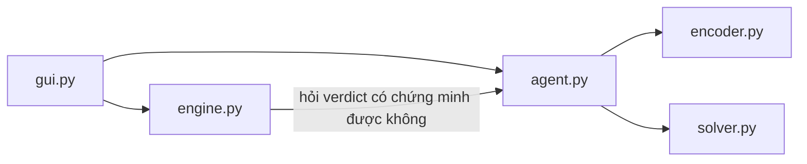

## 0. Thư mục & phân công

```
Source/
├── main.py            # Người 4 – chạy GUI (4.1)
├── gui.py             # Người 4 – Giao diện GUI (4.1)
├── engine.py          # Người 4 – Game Engine giữ đáp án ẩn (4.1)
├── encoder.py         # Người 2 
├── puzzles/*.json     # Người 2 – soạn bộ puzzle test (3x3, 4x4, 5x5)
├── solver.py          # Người 1 – DPLL SAT Solver (4.3)
├── agent.py           # Người 3 – Deductive Logic Agent (4.4)
├── experiments.py     # Người 3 – Thực nghiệm (4.5)
├── requirements.txt   # 
└── tests/
```



> [!IMPORTANT]
> Chỉ `engine.py` được đọc `status` và `clue` của thẻ **chưa lật**. `agent.py` và `gui.py` chỉ dùng **`PublicState`**.

## 1. Quy ước chung

| Khái niệm | Quy ước |
|---|---|
| Mã ô | Chuỗi chữ hoa `"C2"` (cột C, hàng 2) |
| Trạng thái trong JSON | `"CRIMINAL"` / `"INNOCENT"` |
| Trạng thái trong code | `True` = Criminal, `False` = Innocent (hàm `encoder.as_bool()` nhận được cả hai dạng) |
| Biến SAT | `1..N*N`, đánh theo hàng: `encoder.var("B2", 3) == 5`, `encoder.cell_of(5, 3) == "B2"` |
| Literal / mệnh đề / CNF | `int` (`+v` đúng, `-v` sai) / `list[int]` / `list[list[int]]` |
| Thứ tự duyệt ô | `encoder.all_cells(n)` (A1, B1, C1, A2, …) |
| Kết quả phân loại ô | `"CRIMINAL"`, `"INNOCENT"`, `"UNKNOWN"`, `"INCONSISTENT"` |
| Kết quả nộp verdict | `"ACCEPTED"`, `"NOT_PROVABLE"`, `"CONTRADICTED"`, `"ALREADY_KNOWN"`, `"INVALID"` |

## 2. File puzzle (`puzzles/*.json`)

```json
{
  "id": "sample-3x3-01",
  "size": 3,
  "initially_revealed": ["B2"],
  "characters": [
    {"cell": "A1", "name": "Alice", "profession": "Baker", "status": "INNOCENT",
     "clue": {"id": "clue_A1", "type": "EXACTLY", "k": 1, "region": {"kind": "row", "row": 1}}}
  ]
}
```

- Phải có đủ N×N nhân vật; `clue.id` nên đặt là `"clue_<ô>"`.
- Công khai: `id`, `size`, `initially_revealed`, `cell`, `name`, `profession`.
- Ẩn (chỉ Engine đọc, trừ thẻ đã lật): `status`, `clue`.
- Puzzle hợp lệ phải có **đúng 1 nghiệm** và giải được hết mà không cần đoán.
- Ví dụ đầy đủ: [sample_3x3.json](../Source/puzzles/sample_3x3.json).

## 3. Định dạng Clue & Region

| type | Trường |
|---|---|
| `FACT` | `cell`, `status` |
| `SAME`, `DIFFERENT` | `a`, `b` |
| `EXACTLY`, `AT_LEAST`, `AT_MOST` | `k` (0 ≤ k ≤ số ô trong vùng), `region` |
| `NO` | `region` (viết tắt của `EXACTLY` với `k = 0`) |
| `PARITY` (ext) | `parity` (`"ODD"`/`"EVEN"`), `region` (tối đa 8 ô) |

| region kind | Trường |
|---|---|
| `row` | `row` (số) |
| `col` | `col` (chữ) |
| `neighbors` | `of` |
| `explicit` | `cells` |
| `corners`, `boundary` (ext) | — |
| `between` (ext) | `a`, `b` |

Chi tiết: [ENCODER_GIAI_THICH.md](ENCODER_GIAI_THICH.md).

## 4. Encoder API 

| Hàm | Vào | Ra |
|---|---|---|
| `var(cell, n)` / `cell_of(v, n)` | `"B2"`, 3 / 5, 3 | `5` / `"B2"` |
| `all_cells(n)` | n | list ô theo thứ tự hàng |
| `as_bool(status)` | `bool` hoặc `"CRIMINAL"`/`"INNOCENT"` | `bool` |
| `region(spec, n)` | region dict | list ô |
| `check_clue(clue, n)` | clue dict | không trả gì; ném `ClueError` nếu sai |
| `encode_clue(clue, n)` | clue dict | `list[list[int]]` |
| `build_kb(revealed_clues, known, n)` | list clue, `{cell: bool\|str}` | `(clauses, stats)` |
| `evaluate(clue, assignment, n)` | clue, `{cell: bool\|str}` đầy đủ | `bool` |
| `referenced_cells(clue, n)` | clue | list ô (GUI dùng để highlight) |
| `describe_clue(clue, n)` | clue | chuỗi tiếng Anh (GUI hiển thị lên thẻ đã lật) |

`stats = {"primary_vars", "aux_vars" (luôn 0), "clauses", "clues", "units"}`. Tổng số biến luôn là `n*n`.

## 5. Solver — Người 1 (`solver.py`)

```python
def solve(clauses: list[list[int]], num_vars: int, assumptions: list[int] = []) -> dict:
    return {
        "status": "SAT" | "UNSAT",
        "assignment": {1: True, 2: False, ...} | None,   # SAT: gán đủ 1..num_vars
        "stats": {"decisions": int, "propagations": int, "backtracks": int, "runtime_ms": float},
    }
```

Hợp đồng:
1. **Không sửa** list `clauses` truyền vào.
2. `assumptions` = các literal ép đúng tạm thời (giống như thêm unit clause).
3. `[]` (không có mệnh đề nào) → SAT; nếu có mệnh đề rỗng `[]` → UNSAT.
4. Chọn biến tất định: biến chưa gán có số nhỏ nhất, thử `True` trước.
5. Có đủ unit propagation, phát hiện xung đột, đệ quy + quay lui, và 4 thông số trong `stats`.

## 6. Game Engine — Người 4 (`engine.py`)

```python
@dataclass
class PublicState:                     # thứ DUY NHẤT Agent/GUI được thấy
    size: int
    characters: list[dict]             # [{"cell","name","profession"}] cho mọi ô
    known: dict[str, bool]             # verdict đã chứng minh (gồm cả thẻ mở sẵn), True = Criminal
    revealed_clues: list[dict]         # clue đã lật, theo thứ tự lật
    clues_by_cell: dict[str, dict]     # {"B2": clue_dict, ...} để GUI vẽ đúng clue lên thẻ của ô đó
    solved: bool

class GameEngine:
    def __init__(self, path: str): ...       # đọc JSON, gọi encoder.check_clue cho mọi clue
    def public_state(self) -> PublicState: ...
    def submit_verdict(self, cell: str, verdict: str) -> dict: ...
        # {"status": "ACCEPTED"|"NOT_PROVABLE"|"CONTRADICTED"|"ALREADY_KNOWN"|"INVALID",
        #  "cell": "A1", "revealed_clue": dict | None, "message": str}
    def restart(self) -> None: ...
    def full_clues(self) -> list[dict]: ...  # CHỈ dùng cho uniqueness check / thực nghiệm
```

Logic của `submit_verdict(cell, verdict)`:

```text
ô sai / verdict sai → INVALID          ô đã biết → ALREADY_KNOWN
c = agent.classify_cell(public_state(), cell)
c == "UNKNOWN"          → NOT_PROVABLE  (không lật thẻ)
c ngược với verdict     → CONTRADICTED  (không lật thẻ)
c == verdict            → ACCEPTED: thêm vào known, lật thẻ, thêm clue vào revealed_clues & clues_by_cell
c == "INCONSISTENT"     → INVALID ("puzzle lỗi")
```


## 7. Logic Agent — Người 3 (`agent.py`)

```python
def classify_cell(state: PublicState, cell: str) -> str:
    clauses, _ = build_kb(state.revealed_clues, state.known, state.size)
    x, N = var(cell, state.size), state.size ** 2
    if solve(clauses, N)["status"] == "UNSAT":        return "INCONSISTENT"
    if solve(clauses, N, [-x])["status"] == "UNSAT":  return "CRIMINAL"    # KB ⊨ C_x
    if solve(clauses, N, [x])["status"] == "UNSAT":   return "INNOCENT"    # KB ⊨ ¬C_x
    return "UNKNOWN"

def classify(state) -> dict[str, str]          # mọi ô chưa biết → kết quả
def hint(state) -> dict | None                 # {"cell", "verdict", "clue_ids"}: ô bị ép đầu tiên theo thứ tự hàng
def auto_solve(engine) -> dict                 # {"status": "SOLVED"|"STUCK"|"INCONSISTENT", "trace": [...], "totals": {...}}
def check_uniqueness(clues, n) -> bool         # giải → được M1; thêm mệnh đề chặn M1; giải lại: UNSAT ⇒ duy nhất
```

Mỗi bước trong `trace`:

```python
{"step": 1, "active_clues": ["clue_B2"], "kb_clauses": 4,
 "queries": [{"cell": "A1", "query": "KB ∧ ¬C1", "result": "SAT"}, ...],
 "verdict": {"cell": "A1", "status": "INNOCENT"},
 "revealed_clue": "clue_A1", "solver_stats": {...}}
```

`clue_ids` của Hint: các clue đã lật mà `referenced_cells` có chứa ô đó (hoặc thử bỏ từng clue xem ô có còn bị ép không).

## 8. GUI — Người 4 (`gui.py`)

| Thao tác | Gọi |
|---|---|
| Load / Restart | `GameEngine(path)` / `engine.restart()` |
| Vẽ chữ trên thẻ đã lật `cell` | `describe_clue(state.clues_by_cell[cell], n)` |
| Bấm CRIMINAL / INNOCENT | `engine.submit_verdict(cell, verdict)` → hiện `status` + `message` |
| Click một clue | `referenced_cells(clue, n)` → highlight các ô |
| Hint | `agent.hint(engine.public_state())` |
| Auto Solve | `agent.auto_solve(engine)` rồi hiển thị trace, hoặc chạy từng bước |

## 9. Thực nghiệm — Người 3

Xuất `results.csv` với các cột: `puzzle_id, size, primary_vars, aux_vars, clauses, sat_calls, decisions, propagations, backtracks, steps, runtime_ms, status, unique`. **Giữ lại** các ca lỗi/timeout, không xóa.
